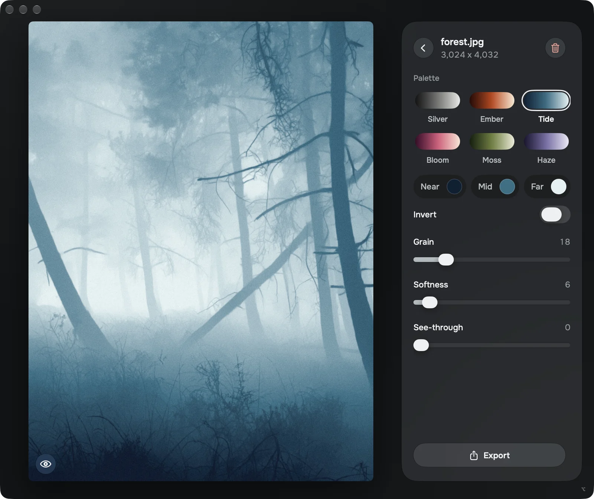
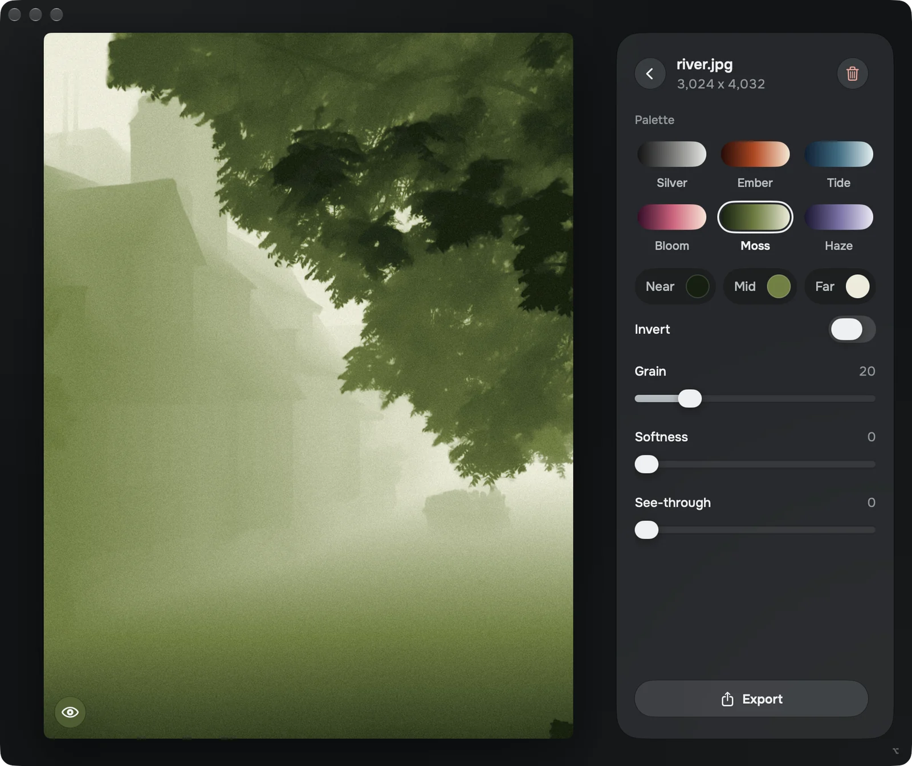
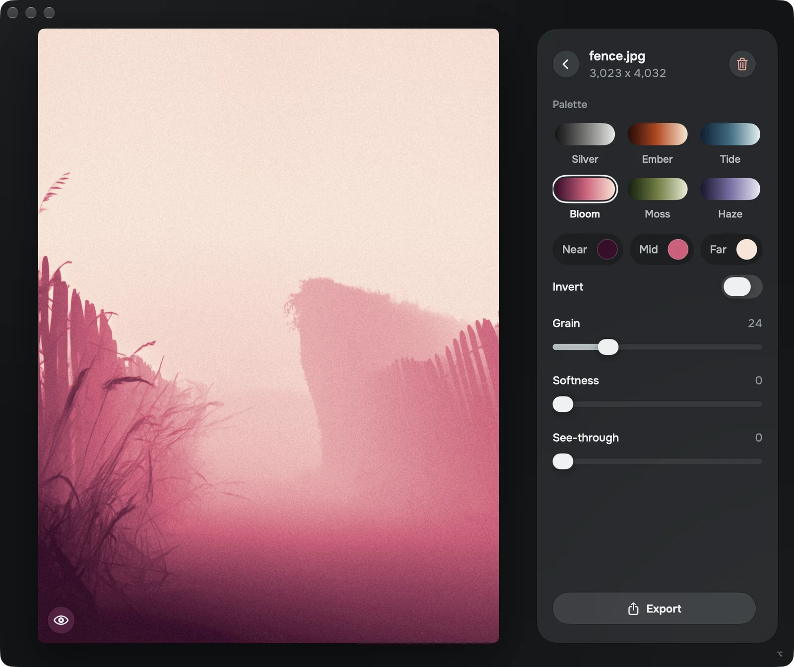

# Arafel

Stylized fog picture editor.

A local open source neural net works out how far away every point in the photo is. Arafel paints that distance in color, adds film grain
and softness, and exports the result at the photo's full size. 

<p>
  
</p>
<p>
  
  
</p>


## Features

- Color presets, customizable
- Grain, softness, see-through settings
- A gallery
- Compare with the original photo (hold Space)
- Full size JPEG export, without the photo's location or camera data

## Install

No coding needed. Expect to wait a while: the model is a big download, and the first build takes several minutes.

**You need** a Mac with Apple Silicon and macOS 26 or newer. To check: Apple menu > About This Mac. "Chip" should
say Apple M1 or later, "macOS" 26 or later.

There are two ways to install it. Pick one.

### Option 1: Install with an AI assistant

The easiest way. It needs an AI assistant that works on your Mac directly, like Claude Code (the Code tab in the
Claude app) or OpenAI's Codex app. Copy this (hover over it, a copy button appears on the right) and paste it in:

```text
Install the Mac app Arafel for me from
https://github.com/davgabriel/arafel, following Option 2
of its README. First check that this Mac has Apple
Silicon and macOS 26 or newer. If Apple's Command Line
Tools are missing or too old for Swift 6.2, start their
installer or tell me how to update them, and wait while
I do it. Then clone the repo into ~/arafel and run
scripts/get-model.sh and scripts/build.sh there. The
build can take over ten minutes: let it run to the end.
Tell me when Arafel is in ~/Applications, or what went
wrong.
```

When it's done, open Arafel: press ⌘ Space, type `Arafel`, press Return.

The ChatGPT and Claude chat windows can't do this, and neither can Claude's Cowork: they don't run commands on the
Mac itself.

### Option 2: Install by hand

Two things to paste into Terminal.

1. **Open Terminal.** Press ⌘ Space, type `Terminal`, press Return.

2. **Install Apple's developer tools.** Copy the line below (hover over it, a copy button appears on the right), paste
   it into Terminal with ⌘ V and press Return.

   ```sh
   xcode-select --install
   ```

   A window asks to install the tools. Click Install and wait until it finishes. If Terminal says they are already
   installed, check for an update in System Settings > General > Software Update (older tools can't build Arafel),
   then go on to step 3.

3. **Download and build Arafel.** The same way: copy, paste, Return.

   ```sh
   git clone https://github.com/davgabriel/arafel.git ~/arafel &&
   cd ~/arafel && scripts/get-model.sh && scripts/build.sh
   ```

   This downloads Arafel and its 1.3 GB model, then builds the app. It's done when the last line says
   `Installed ~/Applications/Arafel.app`.

   If it stops partway, for example because the download broke, paste this to carry on where it stopped:

   ```sh
   cd ~/arafel && scripts/get-model.sh && scripts/build.sh
   ```

4. **Open Arafel.** Press ⌘ Space, type `Arafel`, press Return. The first launch prepares the model, so give it a
   moment. Then drop a photo in.

### Updating and removing

**To update** it, paste this in Terminal:

```sh
cd ~/arafel && git pull && scripts/build.sh
```

**If Arafel says "Depth model missing" or "Depth model damaged"**, paste the carry-on line from step 3.

**To remove it**, delete four things: the Arafel app (in the Applications folder inside your home folder), the
`arafel` folder in your home folder, `~/Library/Application Support/Arafel` and `~/Library/Caches/com.davidgabriel.arafel`.
The last two hold the model (about 2.6 GB, plus about 1.2 GB the Mac keeps for it) and a copy of every photo you
opened, with its look. To find them in Finder: Go > Go to Folder, paste the path.

## How it was made

Vibe-coded with Claude Opus 5.5 on MacOS

## Credits

- Depth model: Apple's [Depth Pro](https://github.com/apple-aiml-research/ml-depth-pro), in the Core ML version from
  [Hugging Face](https://huggingface.co/coreml-projects/DepthPro-coreml-normalized-inverse-depth). It is not part of
  this repo and comes with Apple's own license.
- Fonts: Onest and IBM Plex Mono, both under the SIL Open Font License (included in `Resources/Fonts/`).

## License

MIT for my code - see `LICENSE`. The depth model and the fonts are not mine and MIT does not cover them. They come with
their own licenses - Apple's for the model, the SIL Open Font License for the fonts - and following those is on whoever
uses them.

David Gabriel · [davidgabriel.net](https://davidgabriel.net)
